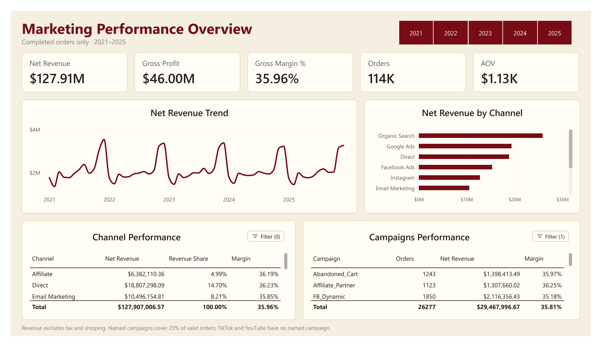
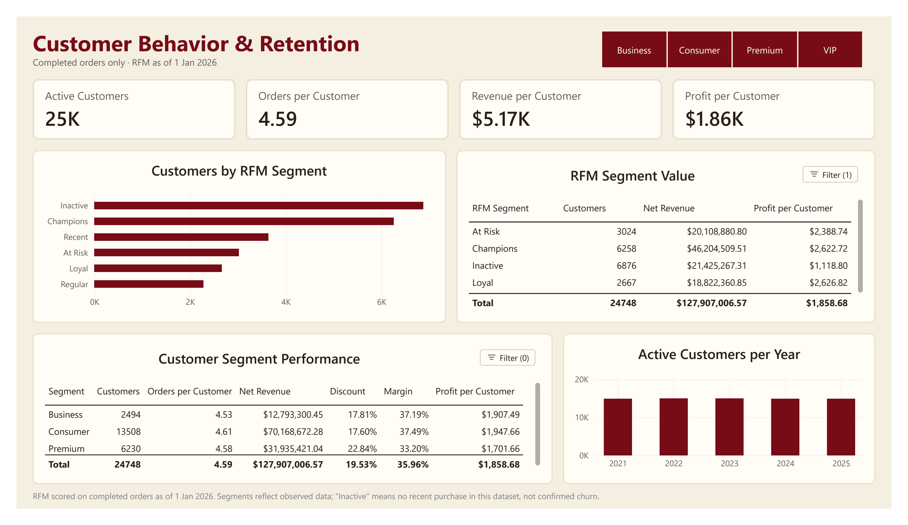
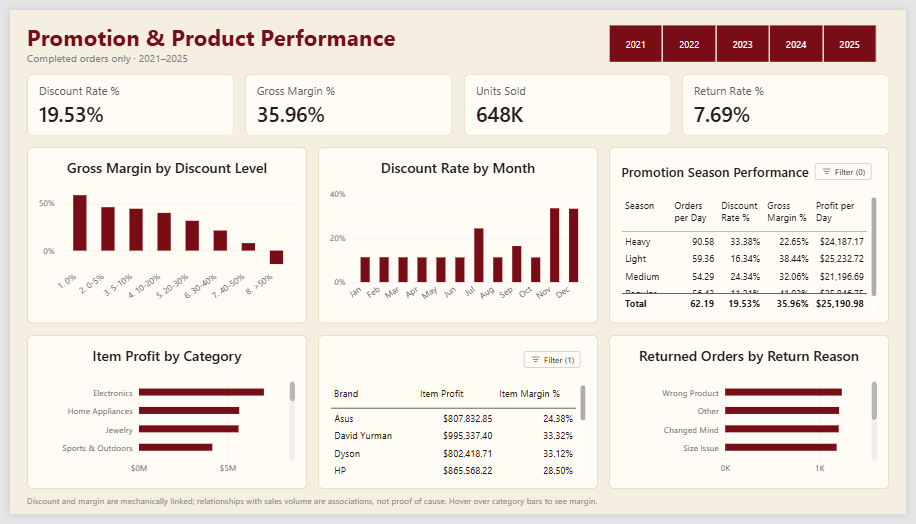

# E-Commerce Marketing Performance & Customer Value Analysis (2021–2025)

I analyzed five years of e-commerce order data to understand how marketing channels, customer segments, promotions, and products contribute to profit—not just revenue.

**Workflow:** Python → MySQL → Power BI

## Project Objective

The goal of this project was to evaluate marketing performance, understand customer value, measure the impact of discounts, and assess product profitability. Along the way, I also reviewed the dataset's existing figures rather than taking them at face value, as some of the numbers turned out to be misleading.

## Key Findings

- **Revenue does not necessarily reflect profitability.** Each channel's revenue contribution largely followed its order volume. Margins were nearly identical across channels (35.7%–36.2%), meaning that a higher sales contribution did not automatically translate into higher profitability.
- **Discounts can quickly erode profit.** The margin fell from 45.9% for orders with discounts below 5% to −14.3% for orders with discounts above 50%. Although orders with discounts above 40% accounted for only 6.1% of all orders, they represented almost all loss-making orders.
- **Higher promotions increased sales, but not profit.** During November and December, when discounts averaged around 33%, daily revenue increased by approximately 73%, while daily profit decreased by around 7%.
- **VIP and Premium customers were not necessarily more valuable.** Their purchase frequency and spending levels were similar to those of other segments, but they received deeper discounts. As a result, their profit per customer was approximately 12% lower.
- **Coupon usage had no measurable impact** on discount levels, order value, or margin.

## Key Metrics

*Based on Completed orders only.*

| Net revenue | Gross profit | Margin | Orders | Average order value | Return rate |
|---|---|---|---|---|---|
| $127.9M | $46.0M | 36.0% | 113,559 | $1,126 | 7.7% |

## Dashboard

| Marketing Performance | Customer Behavior | Promotion & Product |
|---|---|---|
|  |  |  |

## Tools & Technologies

| Tool | Purpose |
|---|---|
| **Python** (Google Colab) | Exploring and validating the data, identifying data issues, cleaning the dataset, and creating exploratory visualizations. |
| **MySQL 8.0** | Storing the data and calculating business metrics in a structured and auditable way. |
| **Power BI** | Presenting SQL results through interactive dashboards designed for non-technical audiences. |

## Limitations

- Campaign cost, impression, and click data were not available. Therefore, **ROAS, CPA, and conversion rate could not be calculated**.
- There was no control group to isolate the impact of promotions. Relationships such as discounts and sales should therefore be interpreted as **associations, not evidence of causation**.
- Approximately 8% of orders were absent from the dataset. Customer metrics are based on the orders available for analysis.

## Repository Structure

```text
├── notebooks/   Python: exploration, cleaning, and data export
├── sql/         Schema, data loading, validation, analysis, and views
├── powerbi/     Dashboard files and theme
├── docs/        Technical documentation
└── images/      Dashboard screenshots
```

## Full Documentation

The full technical documentation covers the analytical approach, technical decisions, and reasoning behind each step. It is available in [TECHNICAL_DOCUMENTATION.md](docs/TECHNICAL_DOCUMENTATION.md).

Dataset: [E-Commerce Sales Analytics Dataset](https://www.kaggle.com/datasets/datascikhan/e-commerce-sales-and-customer-analytics).
## Author

Nurul Huda · nrllhud27@gmail.com
